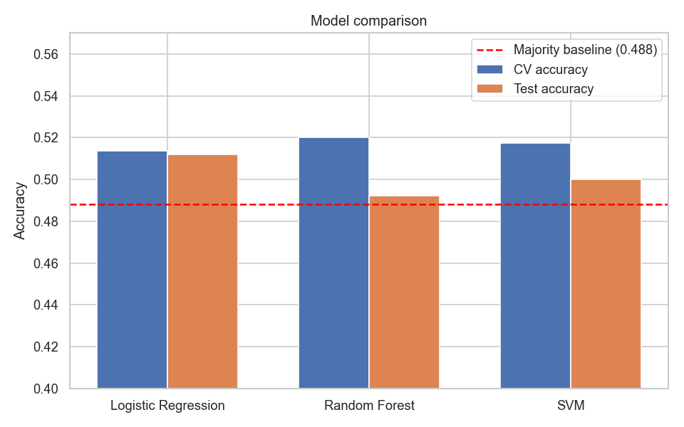
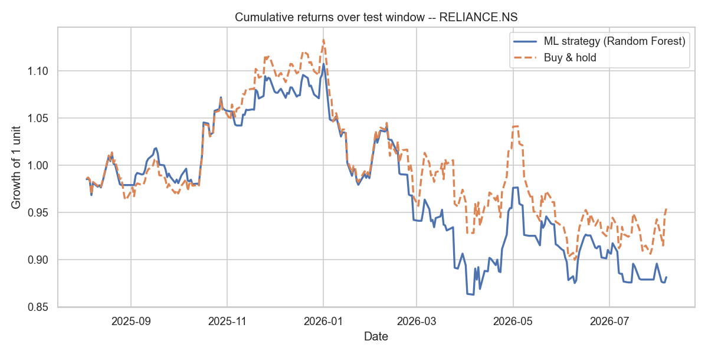
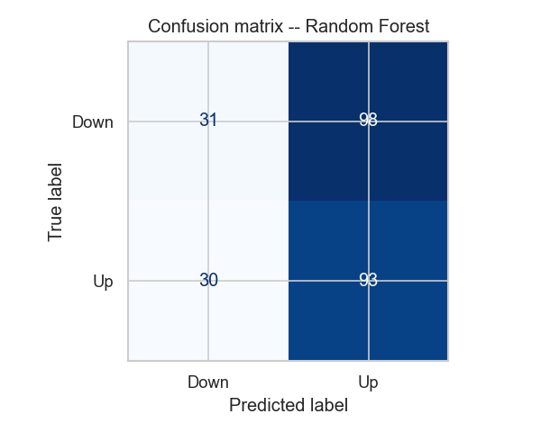
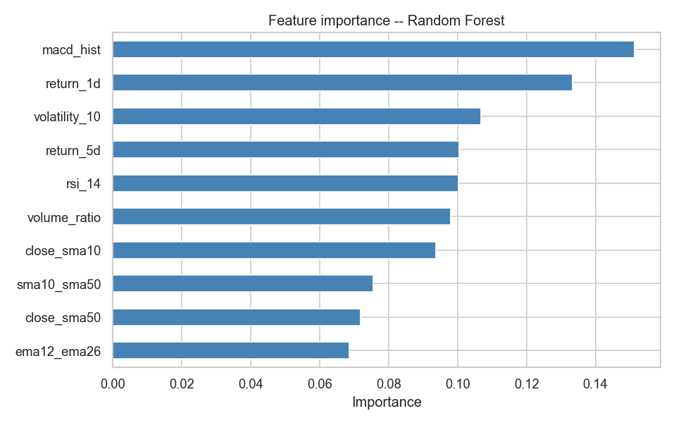

# Algorithmic Trading Signal Predictor

Predicts whether **Reliance Industries (`RELIANCE.NS`)** — or another Yahoo Finance ticker, including the NIFTY 50 index (`^NSEI`) — closes **up or down the next day**, then backtests that signal against buy-and-hold.

The project is an evaluation pipeline, not a claim of a profitable strategy. Next-day direction is close to a coin flip. On the held-out year below, the selected model is only slightly above the majority-class baseline, and the traded strategy **does not** beat buy-and-hold after costs.

**Stack:** Python, pandas, NumPy, scikit-learn, matplotlib, yfinance.

## Demo

A 90-second walkthrough of the pipeline and the out-of-sample result is in [`demo/project_demo.mp4`](demo/project_demo.mp4).

## Run

```bash
pip install -r requirements.txt
python -m main                      # RELIANCE.NS, uses the cached prices
python -m main --ticker ^NSEI       # NIFTY 50
python -m main --refresh            # re-download from Yahoo Finance
```

No API key is required. Daily prices are cached under `data_cache/` as parquet, so a fresh clone runs offline. The command retrains three classifiers (this takes a few minutes), prints the comparison, and writes plots plus `artifacts/best_model.joblib`.

## Result (Reliance, cached sample)

Data: 8 Aug 2016 – 7 Aug 2026 (2,473 sessions). After indicator warm-up, 2,423 rows. The last **252 sessions** (4 Aug 2025 – 6 Aug 2026) are the untouched test window.

Model selection uses cross-validation accuracy only. **Random Forest** (`max_depth=5`, `min_samples_leaf=20`, `n_estimators=200`) wins that comparison and is the model reported below.

| | ML strategy | Buy & hold |
|---|---:|---:|
| Total return | −11.9% | −4.6% |
| Sharpe ratio (annual, 6% risk-free) | −0.93 | −0.42 |
| Max drawdown | −22.1% | −20.6% |
| Trades | 61 | — |

Test-window accuracy **49.2%**, versus a majority-class baseline of **48.8%**. The model mostly predicts Up (186 of 252 days). Transaction cost is 0.1% whenever the position changes.









Numbers move if you pass `--refresh`, because the download window moves with today's date.

## Pipeline

```
data → features → models → backtest → artifacts
```

1. **Data** (`src/data.py`) — OHLCV from `yfinance`, cached as parquet.
2. **Features** (`src/features.py`) — 10 stationary inputs: 1-day and 5-day returns, close/SMA and SMA/SMA ratios, normalised EMA spread, RSI(14), MACD histogram, 10-day volatility, volume versus its 20-day average. Target `y = 1` when the next close is higher.
3. **Models** (`src/models.py`) — logistic regression, random forest, and RBF SVM. Each sits in `Pipeline(StandardScaler → classifier)` and is tuned with `GridSearchCV` + `TimeSeriesSplit`.
4. **Backtest** (`src/backtest.py`) — long/flat. The signal at the close of day *t* is applied to the return from *t* to *t+1*, so the trade does not see the future. Costs are charged on position changes.
5. **Report** (`main.py`, `src/plots.py`) — comparison chart, confusion matrix, equity curves, feature importance.

## Why the test score is not used to pick the model

- The split is chronological. Rows are never shuffled.
- The scaler is fit only inside each training fold.
- Tuning uses an expanding `TimeSeriesSplit`.
- The winner is the highest **CV** accuracy. Test accuracy is reported afterwards.
- The backtest includes transaction costs and is aligned so it cannot trade on future prices.
- The printed baseline is the majority class on the test window, not a flat 50%.

## Layout

```
main.py            entry point
requirements.txt
src/config.py      ticker, test window, costs
src/data.py
src/features.py
src/models.py
src/backtest.py
src/plots.py
data_cache/        parquet cache (committed so the run is reproducible)
artifacts/         plots and the saved model from the Reliance run
demo/project_demo.mp4
```
